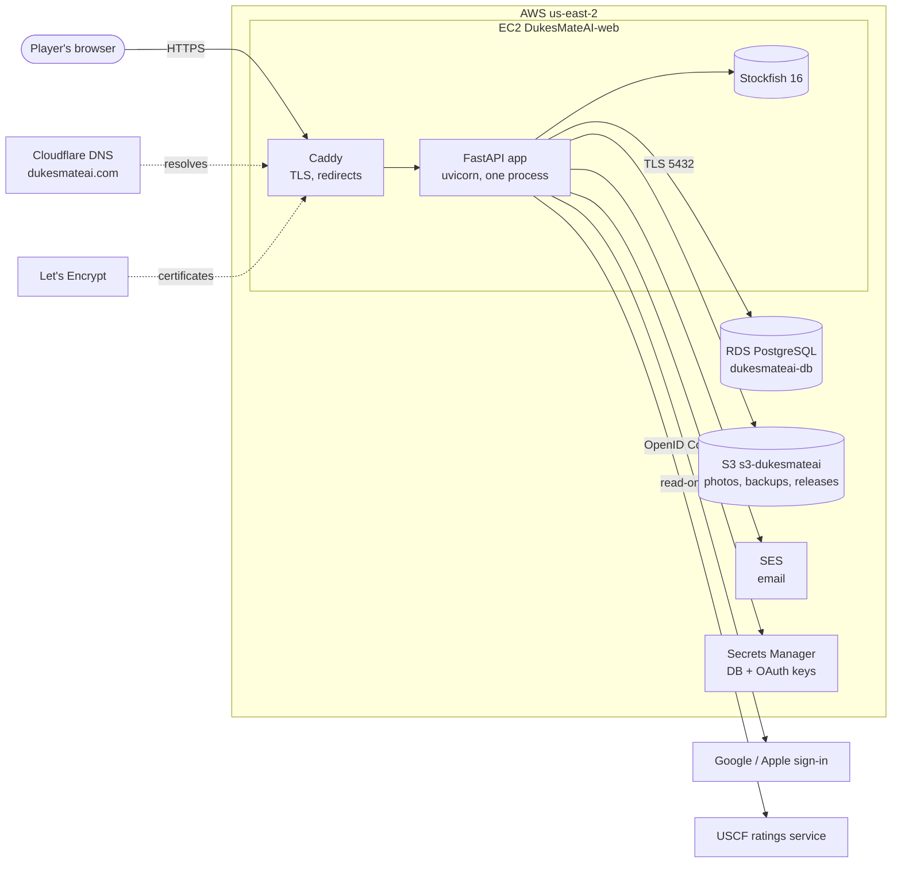
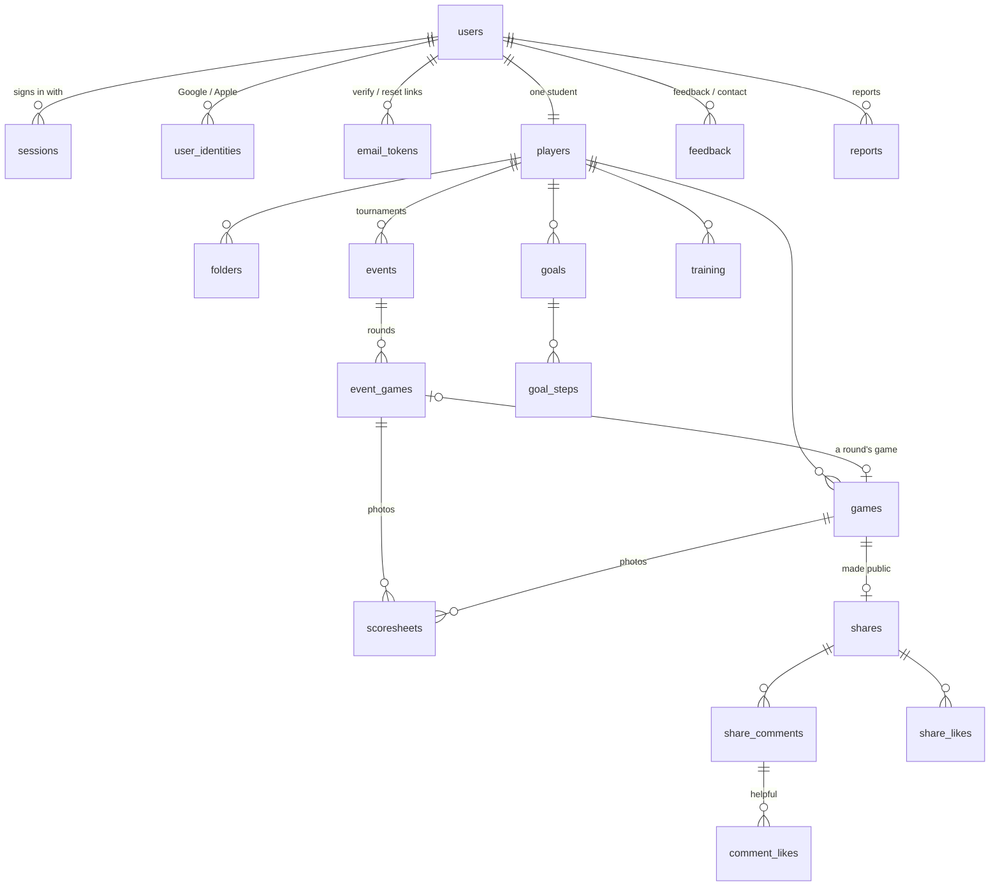
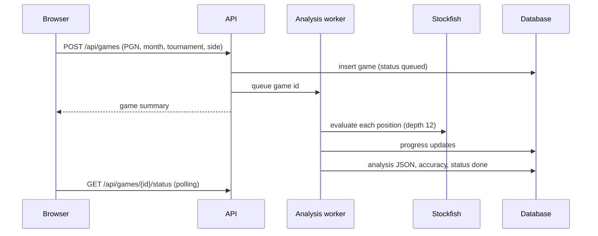

# Chess Varsity: design and architecture

This document explains how Chess Varsity is put together and why: the parts, how data flows between them, the data model, the security design, and the trade-offs behind the main decisions. For running the production copy on AWS, see [deploy/aws/DEPLOYMENT.md](../deploy/aws/DEPLOYMENT.md). For features and local setup, see the [README](../README.md).

The Python package is called `chesscoach` (the app's original working name); everything people see says Chess Varsity.

## 1. Principles

- **The same game always gets the same coaching.** Stockfish measures how much each move cost; deterministic code (`tactics.py`, `balance.py`, `analyzer.py`) names what happened; all wording is templated (`explain.py`, `commentary.py`). No language model judges the chess.
- **One account is one student.** There is no coach or class view. A person sees only their own games, except what others choose to share in the community.
- **Built for young players.** Only display names are ever shown to others, never emails. Sharing is opt-in per game, opponents' names are hidden by default, the community is visible only to signed-in users, and there are reports and moderation.
- **Small and dependable.** One Python process, a plain-JavaScript interface with no build step, few dependencies, and the same code running on SQLite (a laptop) and PostgreSQL (production).
- **Secure by default.** Secrets live only in AWS Secrets Manager, the database is private, cookies are HttpOnly/Secure/SameSite, every query is parameterised, and every endpoint checks ownership.

## 2. System context



| Outside service | Used for | Notes |
|---|---|---|
| Cloudflare | Domain registration and DNS for `dukesmateai.com` and `dukemateai.com` | Records are "DNS only", so traffic goes straight to the server |
| Let's Encrypt | HTTPS certificates | Caddy obtains and renews them itself |
| Amazon SES | Verification, password-reset, feedback, contact and report emails | Sends as `no-reply@dukesmateai.com`, with DKIM, SPF and DMARC |
| Google, Apple | "Continue with Google / Apple" | OpenID Connect authorization-code flow |
| USCF ratings service | Importing a player's tournaments and results | Unofficial, read-only, only when the user presses a button |

## 3. Runtime

Everything runs in **one uvicorn process**, deliberately:

| Part | What it does |
|---|---|
| FastAPI app (`api.create_app`) | HTTP API under `/api`, the single-page interface under `/` and `/static` |
| Analysis worker (`worker.py`) | A background thread with a queue: one Stockfish engine analyses one game at a time. Queued and interrupted games are picked up again after a restart |
| Play engine (`play.py`) | A second Stockfish, used by *Play the computer*, hints and suggested moves. The computer's move: a named-opening book first (keyed by position, built from the 3,800 openings), then a full-strength multi-line search, then a human-like choice among the candidates (per-level temperature and a cap on how bad a move may be, plus random moves for beginners). Levels were tuned by measuring average centipawn loss against a reference search |
| Mailer (`mailer.py`) | A small thread pool that sends email in the background, so a slow mail service never slows a request and response times don't reveal whether an account exists |
| Database pool (`db.py`) | psycopg connection pool (PostgreSQL) or a connection per thread (SQLite) |
| Throttles (`security.Throttle`) | In-memory rate limits for sign-in, sign-up, emails, feedback, contact and comments |

One process keeps the queue, the engines and the throttles simple and consistent. The cost is that the app scales up (a bigger server) rather than out (more servers); see section 11.

## 4. Code layout

```
src/chesscoach/
  Chess core (no web, no database)
    engine.py       Stockfish wrapper: cached multi-line analysis, "what is he threatening?" probes
    tactics.py      threats, forks, pins, exchanges, king-attack potential (no engine)
    balance.py      imbalances in plain language
    analyzer.py     walks a game, classifies each move; timeline, habits, missed wins
    commentary.py   move-by-move commentary
    explain.py      coaching wording
    suggest.py      suggested moves with the board facts that explain them
    thinking.py     the seven-question routine, without naming a best move
    openings.py     opening names and variation tree (lichess chess-openings, CC0)
    academy.py      puzzles, model-game library, repertoire
    prep.py         tournament openings and target positions
    pgnio.py        reading PGN, headers, year/month/tournament/match number
  Product logic
    insights.py     habits, openings, missed wins, dashboard across games
    journey.py      XP, rank (Pawn to King), streak and badges
    goals.py        goal metrics and suggestions
    stats.py        results by month and year
    training.py     training series and their sessions
    gamify.py       community points and levels
    uscf.py         read-only USCF client
  Infrastructure
    config.py       settings from environment variables
    db.py           SQLite / PostgreSQL storage, schema and upgrades
    security.py     password hashing, sessions, one-time email tokens, throttles
    mailer.py       email backends (log, ses, memory)
    storage.py      file storage (local folder or S3)
    oauth.py        Google / Apple OpenID Connect
    worker.py       background analysis queue
  Web
    api.py          app factory, security headers, routers
    deps.py         current user, admin check, read-only "view as" guard
    routes_*.py     one module per area (below)
  static/           the interface: index.html, css/app.css, js/, fonts/, pieces/
tools/              puzzle mining, model-game building, SQLite → PostgreSQL copy
deploy/aws/         production scripts, service files, Caddyfile, DEPLOYMENT.md
tests/              pytest suite (217 tests)
```

### API areas

About 120 endpoints, all JSON under `/api`:

| Module | Prefix | Area |
|---|---|---|
| `routes_account` | `/api/auth` | Register, sign in/out, email verification, forgot/reset password, profile, change password, delete account, stop "view as" |
| `routes_oauth` | `/api/auth` | Providers, OAuth start/callback, disconnect a provider |
| `routes_games` | `/api` | Add, list, edit, delete, re-analyse games; folders; PGN export |
| `routes_scoresheets` | `/api` | Scoresheet photos for rounds and games |
| `routes_events` | `/api` | Tournaments, rounds, calendar, USCF lookup and sync |
| `routes_insights` | `/api` | Dashboard, habits, missed wins, openings, workbook, journey, position balance |
| `routes_plan` | `/api` | Results table (and CSV), goals and steps, tournament plan, thinking trainer |
| `routes_training` | `/api` | Training series and sessions |
| `routes_library` | `/api/library` | Opening library, repertoire, academy, model games |
| `routes_play` | `/api/play` | Levels, computer replies, hints, suggested moves |
| `routes_community` | `/api` | Sharing, feed, comments, likes, helpful marks, points, leaderboard, reports, moderation |
| `routes_roadmap` | `/api` | The development roadmap (`roadmap.py`): level from rating, priorities from the habit scores, topics per level, and each topic's progress |
| `routes_events` (calendar) | `/api` | The calendar feed carries what the details panel needs (statuses, rounds, games with moves, results, goal steps) and, for upcoming tournaments, a preparation checklist; `PATCH /api/events/{id}/prep` ticks a step (stored in `events.prep_done`) |
| `routes_links` | `/api` | Private share links for a game, and the public read-only view (`/api/public/games/{token}`) |
| `routes_feedback` | `/api` | In-app feedback, public contact form |
| `routes_admin` | `/api/admin` | Stats, admins, delete accounts, "view as", reply to and delete messages |

## 5. The interface

- **No build step.** Plain ES modules served as static files (`static/js`), so what is in the repository is what runs.
- **Hash routing** (`router.js`): `#/game/12`, `#/community?filter=questions`. A shared game (`#/g/<token>`) opens in a standalone viewer (`views/publicgame.js`) for anyone, signed in or not. The roadmap (`views/roadmap.js`) links each area and topic to the page where it is practised (`PRACTICE` and `TOPIC_PRACTICE` in `roadmap.py`); the Openings and Attack academy pages show the matching milestones with the same checkboxes (`roadmaplinks.js`), so a tick in either place is saved once. Links from emails put their one-time token after the `#`, so it never reaches server logs or other sites' `Referer` headers.
- **Shell** (`shell.js`): the sidebar (Dashboard, Tournaments, Add games, Improve, Study, Schedule (Calendar, Training, Planner), Community, plus Admin for admins; *Play the computer* is a Study tab), your games by month or folder, and the footer buttons (feedback, board options, theme, sign out). Related pages are grouped as tabs ("hubs", `hubs.js`).
- **Views** (`views/*.js`): one module per page. Each is an async function that fetches what it needs and returns DOM nodes built with a tiny `h()` helper (`dom.js`).
- **Shared pieces**: `api.js` (fetch wrapper with friendly errors), `board.js` (SVG board with arrows), `charts.js` (evaluation timeline), `dialogs.js` (modal dialogs), `share.js` (share dialog), `scoresheets.js` (photo dialog and in-browser photo shrinking), `state.js` (current user and a safe `localStorage` wrapper).

### Visual design

| Element | Choice |
|---|---|
| Theme | "Royal": deep navy sidebar and banner (`#0d1836`), gold highlights (`#d99a0b`), royal blue for actions (`#2748c7`), tinted accents for good/warning/bad; 15 board colour themes |
| Logo | `static/logo.svg`: a gold ducal crown over a strip of chessboard on a navy badge with a gold rim, and a small spark for the AI to come. Also the browser-tab icon. A gold **BETA** tag sits next to the name |
| Dark mode | A matching navy palette, following the system setting unless the person picks one |
| Type | Figtree for text, IBM Plex Mono for chess notation; both bundled (no outside font requests) |
| Components | Cards, tabs, pills, KPI tiles, toasts and modal dialogs, shared across pages |
| Brand buttons | "Continue with Google" (white, multicolour G) and "Continue with Apple" (black) follow the providers' guidelines; the logos are inline SVG because the security policy allows no outside images |
| Accessibility | Labelled controls and buttons, `aria-selected`/`aria-pressed` states, keyboard arrows to step through games, visible focus rings |
| Small screens | The sidebar collapses behind a Menu button; tables scroll sideways |

## 6. Data model

All state is in one relational database. Timestamps are Unix seconds (`REAL`, which becomes `DOUBLE PRECISION` on PostgreSQL).



| Table | Holds |
|---|---|
| `users` | Email, display name, password hash (or none for Google/Apple-only accounts), `email_verified_at`, optional private `phone` and `state` |
| `sessions` | Hash of each sign-in token, expiry, and `impersonator_id` for an admin's read-only "view as" |
| `email_tokens` | Hashes of one-time verification (48 h) and reset (1 h) links |
| `user_identities` | Google/Apple subject IDs linked to accounts |
| `oauth_states` | Sign-ins in progress (10 minutes): state hash, nonce, PKCE verifier |
| `players` | The student: name, rating, rating system, USCF ID and ratings |
| `games` | PGN, headers, opening, status, accuracy, and the full analysis as JSON |
| `folders` | The student's own folders |
| `events`, `event_games` | Tournaments with their plan (registration, hotel, travel) and rounds |
| `scoresheets` | Photo metadata; the image itself is in storage under `storage_key`. Belongs to a round or a game |
| `goals`, `goal_steps` | The goal sheet |
| `training` | Training series (repeats are computed, not stored) |
| `puzzle_progress`, `model_progress` | Puzzles solved, model-game moves seen |
| `shares`, `share_comments`, `share_likes`, `comment_likes` | The community |
| `reports` | Reported shares and comments, and how they were resolved |
| `feedback` | In-app feedback and contact-form messages, with an admin's `reply` |
| `roadmap_progress` | A player's progress on each roadmap topic (a ticked topic is `mastered`; unticking deletes the row) |
| `notations` | Scoresheet photos saved before the moves are entered; `scoresheets.notation_id` points here until the game is added, then the photos move to the game |
| `game_links` | Private share links: token, game, whether to show the opponent, view count |
| `admins` | Admins added from the dashboard (permanent ones are in settings) |

**One schema, two databases.** `db.py` holds the schema in SQLite's dialect. `PostgresDatabase` translates the few differences as each statement runs (`?` to `%s`, `INSERT OR IGNORE`, `COLLATE NOCASE`, returning new IDs) and maps types (`INTEGER PRIMARY KEY` to an identity column, `REAL` to `DOUBLE PRECISION`).

**Upgrades run at start-up** and only ever add: new tables, new columns, relaxed constraints. For example, accounts that existed before email verification are marked verified, and older scoresheet tables gain the `game_id` column. There is no separate migration tool.

## 7. Main flows

### Adding and analysing a game



Optional scoresheet photos from the Add games page are uploaded to the new game right after it is created.

### Signing in

- **Passwords** are hashed with scrypt (standard library). Wrong sign-ins are throttled per address and email, and an unknown email takes as long to check as a known one.
- **Sessions:** the browser gets a random token in a cookie (`HttpOnly`, `Secure` in production, `SameSite=Lax`); only its SHA-256 hash is stored.
- **Email verification:** when switched on, a new account gets a one-time link and cannot sign in until it is opened. The sign-in page offers to resend it, but only after a correct password, so it never reveals which emails have accounts.
- **Forgot password:** always gives the same answer, sends a one-hour, single-use link, and signs the account out everywhere once used. Opening a reset link also confirms the email.

### Continue with Google / Apple

```mermaid
sequenceDiagram
    participant B as Browser
    participant A as API
    participant P as Google / Apple
    B->>A: GET /api/auth/oauth/google/start
    A->>A: store state hash, nonce, PKCE verifier
    A-->>B: redirect to provider + cookie cc_oauth=state
    B->>P: sign in, consent (name, email)
    P-->>B: redirect (Apple: form POST) with code + state
    B->>A: callback with code + state (+ cc_oauth cookie)
    A->>A: state matches cookie and store, single use, under 10 minutes
    A->>P: exchange code (client secret; Apple: signed ES256 JWT)
    P-->>A: ID token
    A->>A: check issuer, audience, expiry, nonce
    A->>A: known account? sign in. Verified email matches? link. Else create
    A-->>B: session cookie, redirect into the app
```

The ID token comes straight from the provider's token endpoint over TLS, so, as the OpenID Connect specification allows, its claims are checked rather than its signature. Apple's answer is a cross-site POST, so that one callback is exempt from the origin check and relies on its own single-use state instead.

### Admin "view as"

An admin can open any account to see exactly what that person sees, for at most an hour. The new session is marked with `impersonator_id` and the admin's own session is kept aside in a cookie. While viewing, the server refuses every change (`deps.require_user`), including connecting Google or Apple. A banner offers *Stop viewing*. These sessions are logged and don't count as the user's sign-ins.

### Community and points

- **Sharing:** a finished game can be made public, with an optional question, from the game page, a tournament round, or *Ask the community*. Others see the display name only; the opponent and tournament are hidden unless the sharer chooses to show them.
- **Talking about it:** comments can point at a specific move. People can like games and mark comments helpful. Reports email the owner and appear on the admin dashboard, where content can be hidden.
- **Points** are computed from activity each time they are shown (`gamify.points`), never stored:

| Action | Points |
|---|---|
| Share a game | 10 |
| Ask a question with it | 5 |
| Comment on someone else's game | 3 |
| First answer to a question | 5 |
| A like on your shared game | 2 |
| Your comment marked helpful | 3 |

Self-likes and hidden content earn nothing, and only 5 shares and 10 comments a day count. Levels are Newcomer (0), Helper (20), Contributor (60), Mentor (150), Coach (300), Master Coach (600) and Grandmaster (1000). Because points are derived, they can't drift out of step, past activity counts, and hiding content removes its points.

### Scoresheet photos

1. The browser shrinks each photo to at most 2,200 px and re-encodes it as JPEG, which also converts iPhone HEIC photos. This keeps each photo to a few hundred KB.
2. The server accepts the raw body, checks the file's own bytes for JPEG, PNG or WebP (not the name or label), and enforces 8 MB and 6 photos per round or game.
3. It stores the image under `scoresheets/<user id>/<random>.jpg` through `storage.py`: a local folder in development, the private S3 bucket (Standard-IA) in production.
4. Images are streamed back only to their owner through `/api/scoresheets/{id}`, so no public links exist. Deleting a photo, round, tournament, game or account deletes the stored files first.

### Email

`mailer.py` has three backends: `log` (write to the log, for local use), `ses` (Amazon SES using the server's IAM role, so there is no email password) and `memory` (tests). Links in emails always use the configured public address, never the request's `Host` header, which a stranger could set.

## 8. Security and privacy

| Threat | Control |
|---|---|
| Stolen passwords | scrypt hashes, sign-in throttling, reset signs out everywhere |
| Session theft | Random tokens, only hashes stored; cookies `HttpOnly`, `Secure`, `SameSite=Lax`; HSTS |
| Cross-site requests | `SameSite` cookies plus an `Origin` check on every write |
| Script injection | Strict Content-Security-Policy (`default-src 'self'`, no inline scripts, no outside images), all text inserted as text nodes (never `innerHTML`), user content escaped in emails |
| Seeing other people's data | Every query is scoped to the signed-in user; other people's items return 404 |
| Admin area discovery | Admin endpoints answer 404 to non-admins; an admin's email must be confirmed, so nobody can claim the address by signing up |
| Admin mistakes while viewing | "View as" is read-only on the server |
| Account enumeration | The same answers and timing for unknown emails (sign-in, forgot password, resend) |
| Spam and abuse | Rate limits on sign-ups, emails, feedback, contact (plus a hidden honeypot field) and comments; reports and moderation |
| Malicious uploads | Content sniffing, size and count limits, private storage, owner-only streaming |
| Leaked secrets | No secrets in the repository or config files: database and OAuth keys are in Secrets Manager and read at start-up; the database admin password is managed and rotated by RDS |
| Network exposure | Only 80/443 open; the app listens on localhost; RDS is in private subnets reachable only from the web server's security group; TLS with certificate checking to the database |
| Cloud permissions | The server's IAM role can only read its own secrets, read releases, write backups, manage scoresheet photos and send email as `@dukesmateai.com` |

**Children's privacy.** The app holds young people's names, games and email addresses. Only display names appear in the community, sharing is opt-in, and accounts can be deleted by their owner or an admin (which removes stored photos too). Before opening it widely: publish a privacy notice (mention "view as" and the community), consider requiring a parent's approval for sharing, and check the rules where you operate (for example COPPA and GDPR).

## 9. Configuration

All settings are environment variables; the full list with defaults is in the [README](../README.md#configuration). In production, non-secret settings live in `/etc/dukesmateai/app.env` and secrets are fetched from Secrets Manager by `run-with-secret.sh` when the service starts.

## 10. Testing

- **Unit and API tests** (`tests/`, 217): chess logic, determinism, the API end to end with FastAPI's test client, email flows with the in-memory mailer, OAuth against a stand-in provider (no network), storage on a temporary folder, admin, community, points and photos.
- **PostgreSQL:** with `TEST_DATABASE_URL` set, every test runs against PostgreSQL in a fresh schema of its own (`tests/conftest.py`). Clear production `CHESSCOACH_*` settings first; for example, secure cookies stop the test client from signing in over plain HTTP.
- **Browser checks:** the main journeys were also exercised in headless Chromium with Playwright during development. Those scripts are not part of the repository.

## 11. Design decisions and trade-offs

| Decision | Why | Trade-off |
|---|---|---|
| Deterministic coaching, no language model | Repeatable, explainable, cheap | Commentary explains what a move does, not deep plans |
| One process, one server | Simple queue, engines and throttles; low cost | Scales up, not out; throttles reset on restart; a restart briefly interrupts service |
| SQLite and PostgreSQL from one codebase | Easy local use; managed, backed-up production database | SQL must stay within a small common dialect |
| No frontend build or framework | Nothing to compile; the repository is what runs | More hand-written DOM code |
| Caddy for HTTPS, no load balancer | Automatic certificates; about $16/month cheaper | A single server; add a load balancer and ACM to run more than one |
| Amazon SES with the server's IAM role | No email passwords; same account as the rest | Sandbox until AWS grants production access |
| Points computed, not stored | Always correct; no counters to repair | Recomputed on each request; fine at this size, would need caching for thousands of active users |
| Photos in S3 Standard-IA, streamed by the app | About half the storage price; access control stays in the app | Every view passes through the server |
| OAuth ID tokens checked by claims, not signatures | The OpenID Connect specification allows this for tokens received directly over TLS; no key fetching or crypto libraries for Google | Relies on TLS to the provider |
| Admin "view as" read-only | Lets the owner help people without risking their data | Admins can see private data, so disclose it in the privacy notice |

## 12. Known limits and next steps

- The USCF service is unofficial and could change.
- Threat detection covers captures, forks and mates; quieter threats are found only through the engine's evaluation.
- Email verification stays off in production until SES production access is granted.
- Apple sign-in needs an Apple Developer Program membership and keys.
- There is no monitoring or alerting yet. A CloudWatch alarm on the server and on RDS, and an uptime check, would be sensible next steps.
- Throttles live in memory, so they reset when the app restarts.
- Reading moves from scoresheet photos automatically (handwriting recognition) is not attempted; photos are kept for reference.
